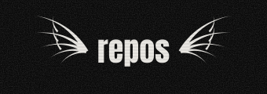
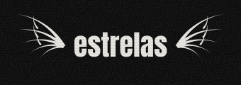
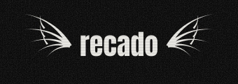
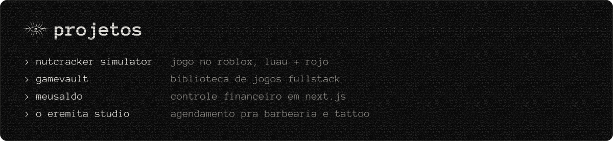

<p align="center">
  <a href="https://github.com/joaozitoito?tab=repositories"></a>
  <a href="https://github.com/joaozitoito?tab=stars"></a>
  <a href="https://github.com/joaozitoito/joaozitoito/issues/new?title=recado&body=deixa%20teu%20recado%20aqui"></a>
</p>



estudante de análise e desenvolvimento de sistemas na unisenac, em pelotas.  
antes do código eu editava vídeo: edit edgy, corte seco, glitch.  
hoje faço jogo no roblox, site, motion e qualquer coisa que dê pra desenhar com código.


```
fazendo    : nutcracker simulator + um jogo de cartas de anime no roblox
estudando  : 5º de 6 semestres
ouvindo    : ----------------
humor      : renderizando...
```




**01 //** nutcracker simulator — jogo no roblox, luau + rojo  
**02 //** gamevault — biblioteca de jogos fullstack  
**03 //** meusaldo — controle financeiro em next.js  
**04 //** o eremita — site de agendamento pra barbearia e estúdio de tattoo




passou por aqui? [deixa um recado](https://github.com/joaozitoito/joaozitoito/issues/new?title=recado&body=deixa%20teu%20recado%20aqui) no meu mural.

<p align="center">
  
</p>


